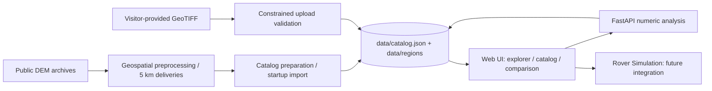

# TerraRover

**Open geospatial exploration · Earth–Mars–Moon terrain characterization · Research-grade transparency**

**TerraRover** is a research-oriented web platform developed by **Killa Coders** for exploring elevation models of terrestrial and planetary environments, examining candidate Earth analog sites, and explaining where a topographic comparison is informative—or limited by its data. It was developed in the context of the **NASA Space Apps Challenge 2026 — Terrestrial Analogues** project.

> **Project status:** public-facing research prototype (v4.2); **not** a validated geological analogue classifier, autonomous rover simulator, or safety certification system. This repository is not an official NASA product or service.

## What visitors can do

- **Explore Earth, Mars and the Moon** through a searchable, mapped terrain catalog and per-region technical sheets.
- **View real terrain products**: numeric 5 × 5 km DEMs, color 2D maps, downloadable GeoTIFFs and interactive 3D terrain viewers where the underlying files are available.
- **Examine morphology** using seven DEM-derived descriptors: hypsometric integral, mean slope, slope variation, elevation skewness, 3D/2D area ratio, a local roughness proxy, and TPI variation.
- **Compare two terrains** using a clearly labeled, **uncalibrated cosine index**, normalized elevation-distribution distances, figures and scale/quality warnings.
- **Find potential Earth analog candidates** against a selected Mars or lunar reference. Candidate ordering is exploratory, *not* a probability of geological or physical equivalence.
- **Submit a community DEM** (where enabled by the host) subject to validation, public-consent requirements and an **unreviewed** data label.
- **Open the Rover Simulation workspace**: reserved for a later genuine simulator integration. **No rover runs or telemetric results are generated in this release.**

## Data scope: catalogued does not mean imported

| Collection | Catalogued regions | Notes |
|---|---:|---|
| Earth | 17 | ASTER, NASADEM and SRTM; some sites have more than one source |
| Mars | 9 | MOLA regional topography, including Jezero and the eight later sites |
| Moon | 7 | SLDEM2015; Shackleton uses a polar LOLA product |
| **Total** | **33** | **Catalog entries, not necessarily 33 scientific DEM files in a new checkout** |

The reference application archive examined for this documentation contains **5 complete example DEM bundles**; the other entries can remain catalogued without local files. The team has separately reported processing additional Martian sets. If your working copy has already imported all 33 final region folders, the number of **available** datasets will be higher. Always check `data/catalog.json` and the actual `data/regions/` files—do not infer successful import from a catalog count.

**Each final team-delivered terrain covers 5,000 × 5,000 m in its projected coordinate system.** This does **not** mean identical spatial detail: typical native sampling is ~30 m on Earth, ~59 m for SLDEM2015, and ~463 m for the MOLA examples. The scientific data are in `DEM.tif`, **not** in the color `Mapa_2D.tiff`.

## Architecture at a glance



**Stack:** HTML, CSS and browser JavaScript (ES modules); Python, FastAPI, Uvicorn, Rasterio, NumPy, SciPy and Matplotlib. No remote AI service is required for the current public analysis. The supplied prototype has a Python backend: **GitHub Pages alone cannot serve its `/api/*` endpoints**.

## Quick start (Windows / VS Code)

From the **actual project root** `TerraRover_Plataforma/`, not from this documentation-only ZIP:

```powershell
python3 -m venv .venv
.\.venv\Scripts\python.exe -m pip install -r requirements-backend.txt
.\.venv\Scripts\python.exe -m uvicorn backend.api:app --host 127.0.0.1 --port 8000
```

Open **http://127.0.0.1:8000/**. In an environment with a compatible Python installed, `python -m venv .venv` can replace the launcher command. The app reads the local `data/catalog.json`; a fresh checkout still needs scientific data imported separately.

To prepare a catalog from the **six-file deliverables**:

```powershell
.\.venv\Scripts\python.exe scripts/preparar_catalogo.py --source "datos_para_importar/entrega_5km"
```

When the application starts, new complete regions in that source directory are also eligible for incremental import. To prevent public uploads while preparing a deployment, set `TERRAROVER_PUBLIC_UPLOADS=false` in the **server environment**. The default in the current code is enabled; **disable it before internet publication unless appropriate abuse controls are deployed**.

### Scientific deliverable contract

```text
TerraRover_Plataforma/
├── data/
│   ├── catalog.json
│   ├── chemistry.json
│   └── regions/<REGION_ID>/
├── datos_para_importar/entrega_5km/
│   ├── <REGION_ID>/
│   │   ├── DEM.tif                 # Scientific numeric elevation
│   │   ├── Mapa_2D.tiff           # Georeferenced color visualization
│   │   ├── Mapa_2D.png            # Browser preview
│   │   ├── Terreno_3D.html        # Plotly interactive relief
│   │   ├── Terreno_3D.obj         # Terrain geometry
│   │   └── metadatos.json         # Dataset/provenance metadata
│   └── plotly.min.js              # Shared by the 3D HTML viewers
├── backend/                       # Scientific API and controlled uploads
├── src/                           # Frontend modules and styles
├── scripts/preparar_catalogo.py
├── simulation/                     # Future simulator integration
├── tests/
└── README.md
```

For all region identifiers and a reproducible handoff, see [the catalog guide](docs/CATALOG_AND_DATA.md) and [data formats](docs/DATA_FORMATS.md).

## Science before scores

The original seven-feature cosine describes **vector alignment**, usually reported in `[-1, +1]`. It is **not a percentage**, not calibrated against independently verified analog sites, and sensitive to unit/scale imbalance. TerraRover additionally computes normalized elevation Wasserstein distance and Kolmogorov–Smirnov statistics. Pixelwise DEM differences are calculated **only** for aligned, co-located rasters of the **same planetary body**. No DEM alone establishes mineral chemistry, regolith strength, actual obstacles or rover traversability.

See [Scientific methods](docs/SCIENTIFIC_METHODS.md) and [Limitations](docs/LIMITATIONS_AND_VALIDATION.md).

## Documentation

**Start here:** [Documentation index](docs/README.md). It links the architecture, upstream geospatial workflow, installation, application workflow, API endpoints, public upload policy, data sources, chemistry context, scientific methodology, simulator integration contract, testing, security, project status and contribution guidelines. A [short Spanish guide](docs/GUIA_RAPIDA_ES.md) is also included.

## Tests

```powershell
node tests/test_frontend.mjs
node tests/test_pages.mjs
node tests/test_live_frontend.mjs
.\.venv\Scripts\python.exe -m unittest discover -s tests -p "test_*.py"
```

`npm test` is defined in `package.json` and aggregates the project's test scripts. Tests do not substitute for scientific ground truth, real cross-browser testing or production security review.

## Credits, sources and licensing

Killa Coders is the project team. Terrain sources are attributed to **NASA/LP DAAC (ASTER GDEM V3, NASADEM, SRTM)**, **NASA PDS/MGS MOLA**, and **NASA PDS/LRO LOLA and SLDEM2015** as applicable. Actual dataset licensing and attribution must be checked **per product**. Any external brand/logo and illustrative image has separate rights and is not automatically covered by a software license.

**No software `LICENSE` file is included in this documentation package**, because the project collaborators have not yet confirmed joint ownership and a licensing choice. Until one is explicitly added, do not assume the code or third-party materials are open-source licensed. See [Licensing and attribution](docs/LICENSING_AND_ATTRIBUTION.md).

---

**TerraRover · Killa Coders · Planetary analog research prototype**
