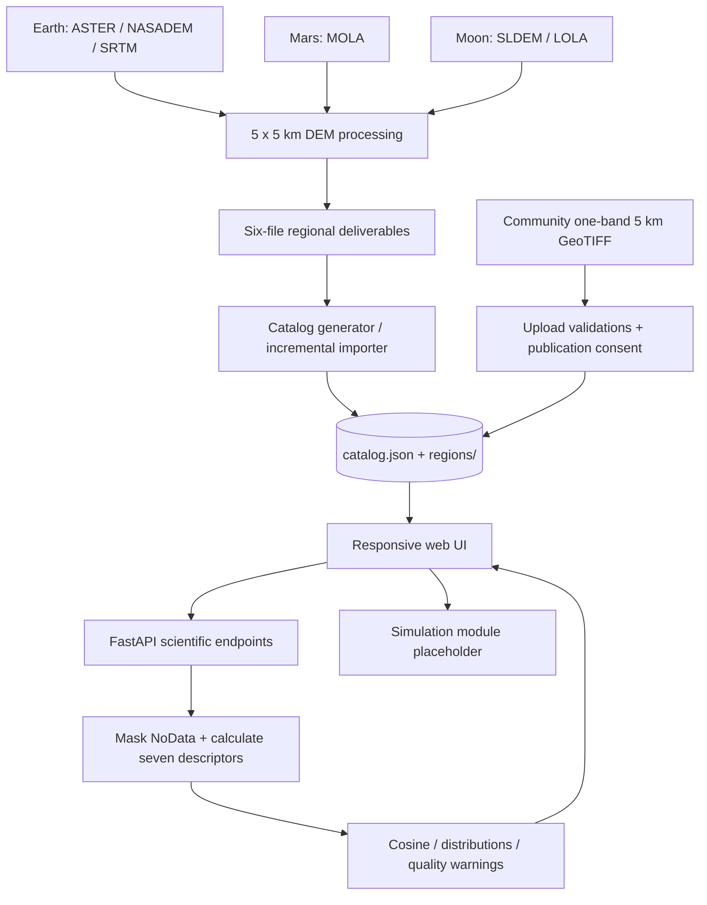

# Architecture and processing flow

## Layers

| Layer | Current module | Responsibility |
|---|---|---|
| Geospatial generation (upstream) | `Killa_Coders_Geospatial` scripts delivered separately | Download, reproject, crop and inspect DEMs; build six regional deliverables |
| Catalog preparation | `scripts/preparar_catalogo.py` | Import final six-file folders, derive preview metadata and features, write `data/catalog.json` |
| Incremental ingest | `backend/community.py::import_new_team_deliverables` | On backend startup, add unseen complete team bundles; do not overwrite published complete entries |
| Browser | `index.html`, `src/*.js`, `src/*.css` | Navigation, filters, map, terrain cards, comparisons, uploads and simulation placeholder |
| Scientific API | `backend/api.py` | Route validation, numeric pairwise analysis, PNG plots, health and upload calls |
| Scientific algorithms | `backend/analysis_engine.py` and `backend/plotting.py` | Raster loading, seven features, similarity/distances, geospatial consistency checks, chart rendering |
| Community upload | `backend/community.py` | Validate a visitor-supplied GeoTIFF and publish it as a separate unreviewed item if enabled |
| Future simulation | `simulation/`, `backend/simulation/` | Reserved; no Webots bridge or live telemetry |

## Data-flow diagram

## Runtime and storage boundaries

- FastAPI serves the application and mounts `/src`, `/assets`, and `/data`. It does **not** mount the root directory, `.env`, upstream raw tiles or a virtual environment.
- The `data/regions/` directory is **public** via the static mount. Only put files there that may legally and operationally be shared.
- The `data/catalog.json` public response includes per-region status, coordinate references and paths to published assets.
- The backend analyses the actual `data/regions/<ID>/DEM.tif`; it never trusts a frontend-supplied file path for pairwise comparisons.
- The frontend retrieves `data/catalog.json` at startup, then calls `/api/analyze` and `/api/chart` using catalog identifiers.
- The community uploader stores a separate `Community_<random>` directory; it does not modify an existing named team region.
- `Rover Simulation` currently renders a placeholder without calling a physics engine.

## Relationship between physical scale and UI

A 5 km by 5 km raster footprint does not guarantee equivalent detail. The pixel count in the final DEM is determined by the available native elevation source, rather than by how large the viewer renders the terrain. For the observed project: Earth ≈ 162 × 162 cells, lunar SLDEM ≈ 85 × 85 cells, and Mars MOLA ≈ 11 × 11 cells. These are representative project outputs, not universal resolutions for all products (the Shackleton polar DEM may differ significantly).

## External services

This public version requires **no third-party AI API**; numerical comparisons are local to the Python backend. Historical AMD TokenLab experiments are not part of public API behavior, and no API key is needed to launch the v4.2 site.
