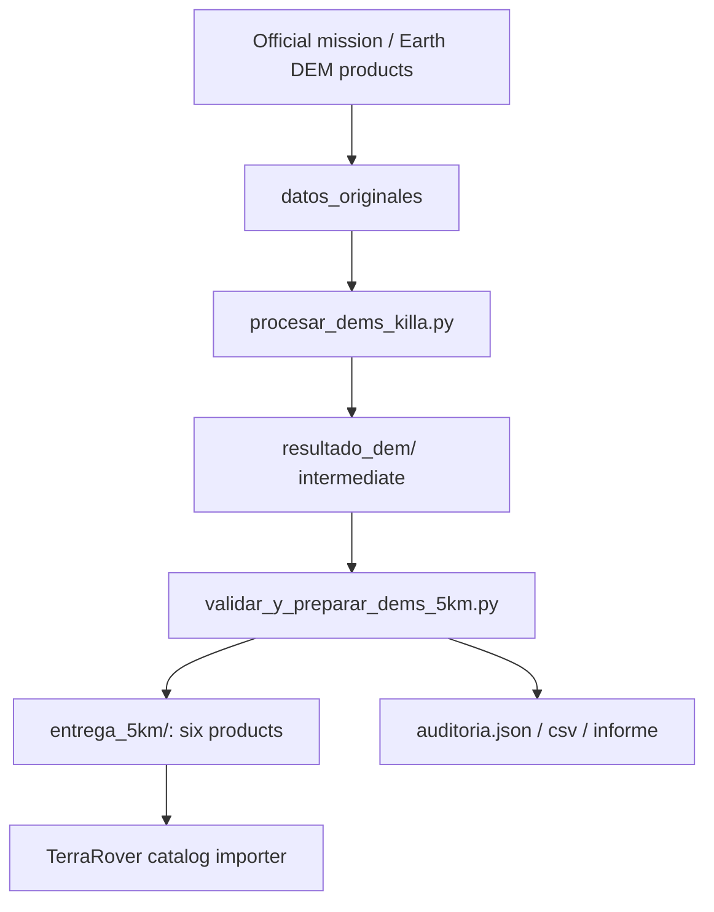

# Upstream geospatial pipeline — Killa Coders

This is **a separate engineering workstream** from the TerraRover public web application. The upstream scripts `procesar_dems_killa.py` and `validar_y_preparar_dems_5km.py` were supplied in the geospatial project and are **not included** in this documentation-only ZIP or required to launch a previously prepared web catalog.

## Two-stage processing

1. **Acquisition and preprocessing:** source datasets are stored under `Killa_Coders_Geospatial/datos_originales/` using ASTER, NASADEM, SRTM, MOLA, SLDEM or LOLA products. The processor selects the region's center, reads the relevant tile and creates an intermediate DEM and visual outputs.
2. **Final preparation and validation:** the validator standardizes every selected region's footprint to exactly **5,000 × 5,000 m**, checks coverage, creates the six canonical assets and writes cumulative audit outputs under `resultado_dem/entrega_5km/auditoria/`.



## The six outputs

`DEM.tif`, `Mapa_2D.tiff`, `Mapa_2D.png`, `Terreno_3D.html`, `Terreno_3D.obj`, `metadatos.json`. The HTML viewers use a single parent-level `plotly.min.js`. The elevation GeoTIFF is numeric and in meters; the 2D TIFF is a visual color rendering.

## Incremental processing commands

The upstream CLI usage was documented and run by the team. Use these **only within the upstream geospatial repository**, with the corresponding source tiles installed:

```powershell
# Check configured planetary sources
py procesar_dems_killa.py --listar-marte
py procesar_dems_killa.py --listar-lunares

# Mars: only the eight additional study windows
py procesar_dems_killa.py --solo-nuevas-marcianas
py validar_y_preparar_dems_5km.py --solo-nuevas-marcianas

# Moon: only the six additional study windows
py procesar_dems_killa.py --solo-nuevas-lunares
py validar_y_preparar_dems_5km.py --solo-nuevas-lunares

# An individual target
py procesar_dems_killa.py --solo Rima_Hadley_SLDEM
py validar_y_preparar_dems_5km.py --solo Rima_Hadley_SLDEM
```

The incremental mode omits already completed region folders. **Do not use `--forzar` without a deliberate plan and backup**; it can regenerate an existing selected result. The team reported that the eight new Mars regions processed with **0 errors** and were validated as **5 km × 5 km**, **11 × 11 cells**, and **100% numeric coverage**. This is terminal evidence, not a separately repeated geologic/terrain validation by the web application.

## Auditor outputs

`auditoria.json`, `auditoria.csv`, `informe.html`, and `comparaciones_fuentes.csv` may accompany the final collection. The historical audit covered **19 complete sets**: 17 Earth, Jezero MOLA and Mare Tranquillitatis SLDEM. Later Martian CLI output listed eight additional sets. Confirmation of every added lunar final output and matching source metadata remains a file-level handoff step, not something to assume from catalog placeholder names.

## Related engineering decisions

- **5 × 5 km**: uniform metric study-window extent, not a promise of identical native resolution or accuracy.
- **1:1 vertical scale**: 3D visualization avoids exaggerated slopes; this does not add sensor detail.
- **No automatic outlier smoothing**: unusual heights can represent real terrain; anomalies are candidates for review.
- **Source tile reuse**: one large input product can yield several different 5 km target windows without duplication.
- **Polar special handling**: Shackleton must use an appropriate lunar stereographic CRS and LOLA polar product, not WGS84 Earth coordinates.
- **Audit vs metadata**: older `metadatos.json` attributes sometimes describe pre-final grids. Confirm final geometry/NoData directly from `DEM.tif`.

## Handoff to the web application

Copy the final **complete** six-file region folders from `resultado_dem/entrega_5km/` into `TerraRover_Plataforma/datos_para_importar/entrega_5km/`, without renaming. Copy the shared Plotly JS once and follow [Setup and local use](SETUP_AND_RUN.md). The web importer does not need or retrieve the enormous original Mars/Lunar mission tiles.
