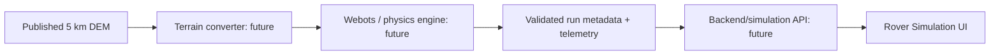

# Rover simulation — integration contract (future)

**Current status:** the public UI contains a **Rover Simulation** page and there are two reserved directories, `simulation/` and `backend/simulation/`, containing placeholders. **No operational simulator, physics integration or live rover telemetry is part of TerraRover v4.2.**

## Intended future interface

Inputs should include a **specific published region ID**, the version/hash and CRS of its scientific `DEM.tif`, conversion parameters, chosen rover model/configuration, simulator details and any environmental assumptions. A terrain visualizer or OBJ export is not automatically a collision-correct, physically meaningful simulation world.

The user previously reported a separate role's work converting TIFF terrain into Webots and producing telemetry. The actual integration code and validated simulation runs were **not** connected to this web repository at the time this documentation was prepared.

## Suggested integration boundaries



The frontend should not require direct access to a developer workstation's Webots GUI. Prefer a structured service that processes independent run IDs, permissions and durable result files. Keep simulation modules independent of the geospatial catalog importer and numerical comparison endpoints.

## Proposed telemetry interface (contract to validate with the simulation team)

Summary JSON keys, derived from the simulation engineer's handoff:

```text
distance_travelled
average_speed
elapsed_time_sec
maximum_slope
max_roll_deg
max_pitch_deg
max_uninterrupted_distance
stall_events
stability_loss_events
route_completion
```

Time-series CSV columns, as reported:

```csv
time_sec,x,y,z,speed_ms,roll_deg,pitch_deg,slope_deg,uninterrupted_dist_m,stall_flag,instability_flag,progress_pct
```

Possible visual files: PNG plots, route views and scene recordings, **only when genuinely generated**. Units, timestamps, reference frames, uncertainty, run status and provenance should be added to the schema before releasing a public integration.

## Before implementation

1. Agree on coordinate mapping between raster grid, 3D mesh and simulation world frame.
2. Match rover size to DEM spatial sampling; an ~463 m/cell MOLA source cannot model wheel-scale terrain.
3. Validate collision mesh orientation, vertical scale (1:1), slopes, gravity/traction settings and vehicle parameters.
4. Store a run manifest linking source DEM, software versions, simulator parameters, output files and pass/fail state.
5. Decide how the user launches/cancels runs, authorization, queue capacity, compute costs and storage policy.
6. Test repeatability and compare against a controlled reference scenario; do not claim physical safety from a visually successful run.

**No `wbt`, `proto` or simulator code is invented or included in the documentation ZIP.** The existing reserved folders can receive the actual implementation when it is ready.
